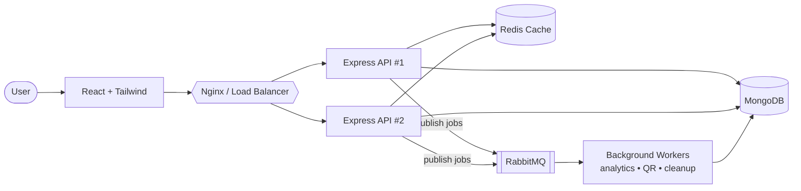
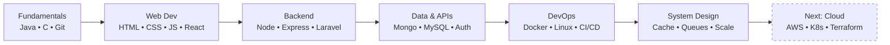

<div align="center">


<p>
  
  
  
</p>

<p>
  <a href="https://kartikeyamishra.vercel.app"></a>
  <a href="https://linkedin.com/in/kartikeya-mishra-8199973a9"></a>
  <a href="mailto:kartikeya2122008@gmail.com"></a>
</p>

</div>

---

## 👋 About Me

I don't just want my apps to *work* — I want to know **how they talk, how data flows, how they fail, and how to make them reliable.**

Started with programming fundamentals → frontend → backend APIs → databases → auth → full-stack apps. Now going deeper into **containers, CI/CD, caching, queues and scalable architecture.**

> 🎯 **Goal:** Move beyond writing code to understanding the systems that make software reliable, maintainable and scalable.

```js
const kartikeya = {
  role: "Full Stack Developer → Backend / DevOps focused",
  currentlyBuilding: "WhyLong — URL shortener with queues, caching & rate limiting",
  currentlyLearning: ["AWS", "Kubernetes", "Terraform", "Observability"],
  stack: ["React", "Node.js", "Express", "MongoDB", "Redis", "RabbitMQ", "Docker"],
  philosophy: "Build → Break → Understand → Improve → Repeat",
  openTo: ["Internships", "Open-source", "Collabs", "Backend/Full-stack roles"],
};
```

---

## 🛠️ Tech Stack

<div align="center">

| | |
|:--|:--|
| **💻 Languages** |  |
| **🎨 Frontend** |  |
| **⚙️ Backend & DB** |  |
| **🐳 DevOps & Tools** |  |
| **🧠 Exploring** |  |

</div>

---

## ⚡ Engineering Focus

<table>
<tr>
<td width="50%" valign="top">

### 🌐 Full Stack
- React, responsive UI, component architecture
- REST APIs & app integration
- AuthN / AuthZ (JWT, cookies, bcrypt)
- Forms & validation (React Hook Form + Zod)

</td>
<td width="50%" valign="top">

### ⚙️ Backend
- Node.js, Express, PHP, Laravel
- SQL & NoSQL schema design
- Middleware, validation, error handling
- Caching, queues, WebSockets

</td>
</tr>
<tr>
<td width="50%" valign="top">

### 🐳 DevOps
- Dockerfiles, networking, volumes, Compose
- GitHub Actions CI/CD
- Linux & environment config
- Secrets management & deployment

</td>
<td width="50%" valign="top">

### 🏗️ System Design
- Caching & rate limiting
- Load balancing & horizontal scaling
- Async job processing & backpressure
- Resilience & failure handling

</td>
</tr>
</table>

---

## 🚀 Flagship Project — WhyLong

<div align="center">

### 🔗 More than shortening a URL — it's a backend engineering playground.

<a href="https://whylong.vercel.app"></a>
<a href="https://github.com/devKartikeya/WhyLong"></a>

</div>

**Features:** short links & link management · customizable branded QR codes · click analytics · authenticated dashboards · responsive React + Tailwind UI

### 🧩 Architecture



### 🔬 What it demonstrates

| Area | Implementation |
|:--|:--|
| **API layer** | Node.js, Express, REST |
| **Data** | MongoDB + Mongoose |
| **Auth** | JWT & cookie-based flows |
| **Performance** | Redis caching → fewer repeated DB reads |
| **Security** | Rate limiting & request protection |
| **Async work** | RabbitMQ background jobs |
| **Reliability** | Backpressure & resource management |
| **Infra** | Docker, CI/CD, load balancing, horizontal scaling |

`React` `TailwindCSS` `Node.js` `Express` `MongoDB` `Redis` `RabbitMQ` `Docker` `GitHub Actions`

---

## 🧰 More Projects

| Project | What it is | Stack | Links |
|:--|:--|:--|:--|
| 💰 **Xpense Tracker** | Full-stack finance app — income/expense tracking, charts, ledger, admin controls, password reset, PDF/Excel export | MongoDB · Express · React · Node | [Live](https://expense-tracker-mern-project-seven.vercel.app) · [Code](https://github.com/devKartikeya/expense-tracker-mern-project) |
| 🌍 **Heritage Junction** | Travel platform — destinations, packages, itineraries & booking workflows | Laravel · PHP · React · Inertia · MySQL | [Code](https://github.com/devKartikeya/Heritage-Junction) |
| ⚙️ **Node.js CI/CD Pipeline** | Hands-on automation — GitHub Actions, Docker builds, secrets & env config | Node.js · Docker · GitHub Actions | [Code](https://github.com/devKartikeya/Nodejs-GitHub-Actions-CI-CD-Pipeline) |
| 🎨 **Developer Portfolio** | Glassmorphism UI with GSAP + ScrollTrigger animations, EmailJS contact form | React · Tailwind · GSAP · Vite | [Live](https://kartikeyamishra.vercel.app) · [Code](https://github.com/devKartikeya/Kartikeya-Mishra) |

---

## 🧠 How I Think About Engineering

<details>
<summary><b>Click to expand — the "why" behind each tool</b></summary>
<br>

| Question | What I want to understand |
|:--|:--|
| SQL or NoSQL? | Relationships, consistency, query patterns, trade-offs |
| Why Docker? | Reproducible environments, consistent deployments |
| Why Redis? | When caching helps — and how invalidation affects correctness |
| Why a message queue? | Decoupling workloads, async processing |
| Why rate limiting? | Protecting resources from abusive traffic |
| Why a load balancer? | Spreading requests across app instances |
| Why CI/CD? | Repeatable delivery, less manual work |
| Why monitoring? | Detecting failures, understanding system behavior |

> The interesting part isn't learning a tool — it's knowing **when to use it, what it costs, and which problem it solves.**

</details>

---

## 🗺️ Journey & Roadmap



- [x] Build & deploy full-stack applications
- [x] Work with SQL and NoSQL databases
- [x] Implement authentication & protected APIs
- [x] Docker + GitHub Actions practice projects
- [x] Docker Compose & production container workflows
- [x] System design & scalability fundamentals
- [ ] Cloud infrastructure with **AWS**
- [ ] **Kubernetes** & **Terraform**
- [ ] Deeper Redis, messaging & distributed systems
- [ ] Monitoring, logging & observability
- [ ] Contribute to open-source

---

## 📊 GitHub Stats

<div align="center">


</div>

---

## 🧭 Principles

| | |
|:--|:--|
| 🔍 **Understand first** | Learn the problem before picking a solution |
| 🔨 **Build to learn** | Turn concepts into working projects |
| 📚 **Fundamentals > hype** | Know the trade-offs behind tools |
| 🤖 **Automate wisely** | Remove repetitive, error-prone work |
| 🧹 **Design for change** | Readable, maintainable code |
| 🐞 **Learn from failure** | Fix the cause, not the symptom |

---

## 🤝 Let's Connect

Open to **internships, collaborations and open-source** — if you're building something interesting around backend, DevOps or full-stack, say hi!

<div align="center">

<a href="https://github.com/devKartikeya"></a>
<a href="https://linkedin.com/in/kartikeya-mishra-8199973a9"></a>
<a href="mailto:kartikeya2122008@gmail.com"></a>

**Build → Break → Understand → Improve → Repeat** 🔁


</div>
